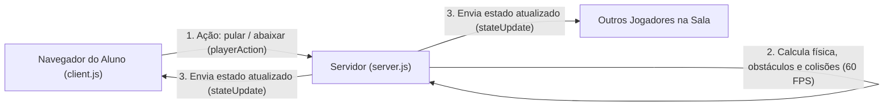

# 🦖 Dino Runner Multiplayer — Guia Didático

Um jogo 2D **multiplayer em tempo real** inspirado no clássico dinossauro do Google Chrome, desenvolvido com **HTML5 Canvas**, **CSS**, **JavaScript**, **Node.js**, **Express** e **Socket.io**.

Este repositório foi pensado para **fins educacionais**, demonstrando na prática como jogos online sincronizam múltiplos jogadores usando **WebSockets** e um **servidor autoritativo**.

---

## 🎯 O que você vai aprender com este projeto

- **Comunicação bidirecional em tempo real** com **Socket.io (WebSockets)** — sem precisar recarregar a página.
- **Arquitetura Cliente-Servidor Autoritativa** — o servidor é a "fonte da verdade" das posições, física, obstáculos e pontuações.
- **Game Loop (Loop de Jogo)** — simulação física fixa a 60 FPS no servidor (`setInterval`) e renderização suave no navegador (`requestAnimationFrame`).
- **Desenho 2D com HTML5 Canvas** — criação de personagens em *pixel art* diretamente por código (`ctx.fillRect`), sem depender de imagens externas.
- **Física 2D básica e Detecção de Colisão (AABB)** — gravidade, pulo, *jump buffer*, queda rápida e *hitboxes*.
- **Rede Local (LAN)** — descoberta do IP local do servidor com o módulo nativo `os` do Node.js para jogar com colegas na mesma rede Wi-Fi ou laboratório.
- **Áudio procedural no navegador** — efeitos sonoros retrô 8-bit gerados via **Web Audio API**.

---

## 🗂️ Estrutura do Projeto

```text
dino-runner-multiplayer/
├── server.js            # Servidor Node.js + Express + Socket.io (física, obstáculos e estado do jogo)
├── package.json         # Dependências e scripts do projeto (npm start)
├── .gitignore           # Arquivos ignorados pelo Git (ex.: node_modules)
├── README.md            # Esta documentação
└── public/              # Arquivos estáticos enviados ao navegador
    ├── index.html       # Estrutura da página (Canvas, controles, IP local e placar)
    ├── style.css        # Estilização e responsividade da interface
    ├── client.js        # Conexão Socket.io, captura de teclas, áudio e desenho no Canvas
    └── favicon.svg      # Ícone vetorial (SVG) do dinossauro na aba do navegador
```

> **Curiosidade:** o dinossauro, os cactos, os pterodáctilos, as nuvens e a lua **não são imagens PNG/JPG**. Tudo é desenhado em tempo real no `<canvas>` através de pequenos retângulos (`ctx.fillRect`) dentro de `public/client.js`!

---

## 🧠 Como o Jogo Funciona (Arquitetura)

Em vez de cada navegador decidir sozinho onde estão os obstáculos ou se houve colisão, o **servidor controla a regra do jogo** e envia o estado atualizado para todos os jogadores:



### Por que usar um Servidor Autoritativo?
1. **Sincronização justa:** todos os jogadores veem exatamente os mesmos cactos e pterodáctilos no mesmo instante.
2. **Menos trapaças:** como a pontuação e as colisões são calculadas no servidor, alterar variáveis no console do navegador não muda o placar oficial.

---

## 📡 Mapa de Comunicação (Eventos e Rotas)

### Eventos enviados pelo Cliente (`client.js` → `server.js`)
| Evento | Dados enviados | O que faz |
| :--- | :--- | :--- |
| `playerAction` | `{ type: 'jump' \| 'duckStart' \| 'duckEnd' \| 'restart' }` | Informa ao servidor que o jogador pulou, abaixou, levantou ou reiniciou a rodada. |
| `setName` | `{ name: 'T-Rex' }` | Atualiza o apelido exibido no placar e acima do dinossauro. |

### Eventos enviados pelo Servidor (`server.js` → `client.js`)
| Evento | O que envia | Para que serve |
| :--- | :--- | :--- |
| `init` | ID do jogador, dimensões da pista (`config`) e dados da rede (`network`) | Configura o Canvas e exibe o IP local e a porta na tela. |
| `stateUpdate` | Status da partida, velocidade, dia/noite, lista de obstáculos e todos os jogadores | Atualiza o placar lateral e alimenta o desenho de cada frame no Canvas. |

### Rota HTTP auxiliar
- `GET /api/network`: retorna um JSON `{ ip, port, url }` com o IPv4 local da máquina que está hospedando o servidor.

---

## 🔍 Guia Rápido para Estudar o Código

Se você quiser explorar o código por partes, comece por estes trechos:

1. **Constantes de Física (`server.js`)**:
   - `GRAVITY`, `JUMP_VELOCITY`, `FAST_FALL_GRAVITY`, `BASE_SPEED` e `MAX_SPEED` controlam toda a sensação de jogabilidade.
2. **Detecção de Colisão AABB (`checkCollision` em `server.js`)**:
   - Verifica se o retângulo do dinossauro encostou no retângulo de algum obstáculo, usando uma pequena margem (`HITBOX_PADDING_X` / `HITBOX_PADDING_Y`) para o jogo não parecer injusto.
3. **Desenho dos Personagens (`public/client.js`)**:
   - `drawStandingDino` e `drawDuckingDino`: desenham o dinossauro em pé e abaixado, alternando as pernas conforme o contador `tick`.
   - `drawCactus` e `drawPtero`: desenham os obstáculos e animam as asas do pterodáctilo.
   - `render`: função executada em loop pelo `requestAnimationFrame` (~60 vezes por segundo).
4. **Efeitos Sonoros sem MP3 (`playTone` em `public/client.js`)**:
   - Usa osciladores (`AudioContext`) para sintetizar sons retrô diretamente no navegador.

---

## 🚀 Passo a Passo para Executar

### Pré-requisitos
- [Node.js](https://nodejs.org/) (versão 18 ou superior)
- [Git](https://git-scm.com/) (opcional, caso vá clonar o repositório)

### 1. Baixe o projeto
```bash
git clone https://github.com/andersonrmgomes/dino-runner-multiplayer.git
cd dino-runner-multiplayer
```

### 2. Instale as dependências
```bash
npm install
```

### 3. Inicie o servidor
```bash
npm start
```

> **Modo desenvolvimento (com reinício automático):** durante os exercícios/alterações no `server.js`, use `npm run dev` (`node --watch server.js`) para o servidor reiniciar sozinho toda vez que você salvar o arquivo.

No terminal, aparecerão os endereços de acesso:
```text
Servidor Dino Multiplayer rodando em:
  Local: http://localhost:3000
  Rede:  http://192.168.X.X:3000
```

### 4. Jogue sozinho ou em grupo na sala de aula
- **No mesmo computador:** abra `http://localhost:3000` em duas ou mais abas para testar o multiplayer.
- **Com colegas na mesma rede Wi-Fi / laboratório:** olhe o card **IP Local e Porta** no painel lateral do jogo, clique em **Copiar** para enviar o link (`http://SEU-IP:3000`) ou clique em **QR Code** para os colegas escanearem direto pelo celular!
- **Turma grande na mesma sala:** use o botão **👀 Todos / 🎯 Só eu** no topo da tela para ocultar os outros dinossauros da pista (modo foco) sem sair do placar multiplayer.

> **Dica de laboratório (Windows):** se outro computador da rede não conseguir abrir o endereço `http://SEU-IP:3000`, verifique se o **Firewall do Windows** permitiu o acesso do **Node.js** em redes privadas.

---

## 🎮 Controles

| Ação | Teclado | Mouse / Celular |
| :--- | :--- | :--- |
| **Iniciar / Pular / Reiniciar** | `Espaço`, `↑` ou `W` | Clique/toque no Canvas ou botão **⬆ Pular** |
| **Abaixar** (ou queda rápida no ar) | `↓` ou `S` | Segurar botão **⬇ Abaixar** |
| **Reiniciar após Game Over** | `Espaço`, `↑`, `W` ou `R` | Clique/toque no Canvas |

---

## 💡 Desafios Práticos para os Alunos

Experimente modificar o projeto aos poucos para fixar os conceitos:

### 🟢 Nível Iniciante
1. **Novas cores:** adicione novas cores no array `DINO_COLORS` em `server.js`.
2. **Modo Lua / Gravidade baixa:** altere `GRAVITY` e `JUMP_VELOCITY` em `server.js` e observe como muda o pulo.
3. **Personalização visual:** mude as cores do céu dia/noite em `render()` no `public/client.js` ou edite o ícone em `public/favicon.svg`.

### 🟡 Nível Intermediário
4. **Novo obstáculo:** crie um novo tipo de obstáculo (como um meteoro ou cacto gigante) em `spawnObstacle()` (`server.js`) e sua função de desenho em `public/client.js`.
5. **Bônus coletável:** adicione uma estrela/moeda que aparece no céu e dá `+50` pontos para quem pular e pegar primeiro.
6. **Personalizar apelido automático:** faça o servidor sortear nomes divertidos (ex.: `Rex`, `Raptor`, `Tricera`) em vez de `Dino-xxxx`.

### 🔴 Nível Avançado
7. **Trocar por imagens (Sprites):** substitua `drawStandingDino` por uma imagem PNG/sprite sheet usando `ctx.drawImage()`.
8. **Salas separadas:** use `socket.join(nomeDaSala)` no Socket.io para permitir que grupos diferentes joguem partidas independentes no mesmo servidor.
9. **Persistência de recorde:** salve o `highScore` da sala em um arquivo JSON usando o módulo `fs` do Node.js para que o recorde não zere quando o servidor for reiniciado.
